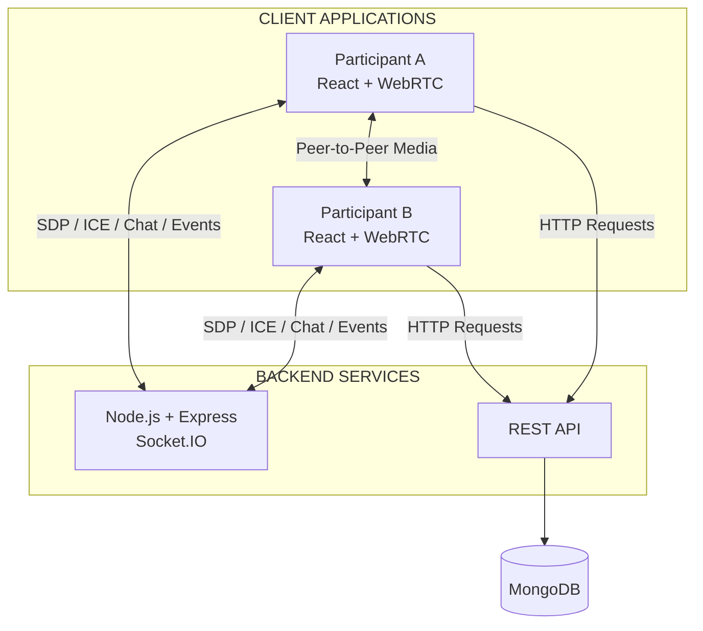
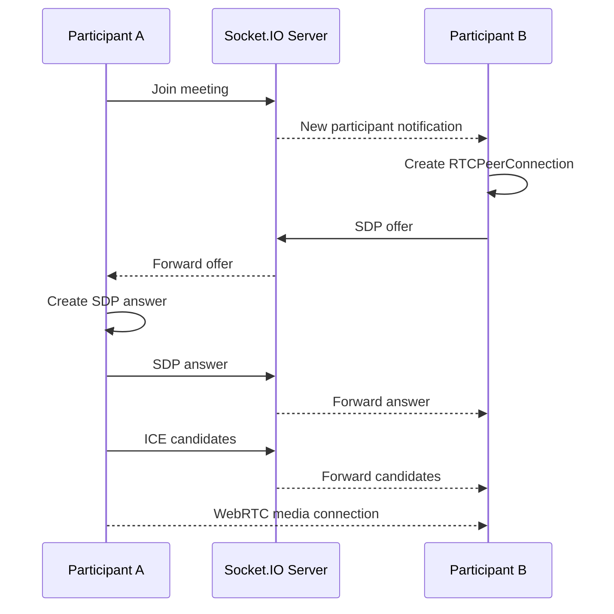

# MeetSpace

<p align="center">
  <strong>REAL-TIME COMMUNICATION. REIMAGINED.</strong>
</p>

<p align="center">
  A full-stack video conferencing platform built for seamless audio, video, screen sharing, and real-time collaboration.
</p>

[🚀 **Live Demo — Try MeetSpace**](https://meetspacefrontend-8v0s.onrender.com)

[💻 View Source Code](https://github.com/Harshit-Webworld1515/MeetSpace)

---

<p align="center">
  <a href="https://github.com/Harshit-Webworld1515/MeetSpace">
    
  </a>
  
  
  
</p>

<p align="center">
  <a href="#-features">Features</a> •
  <a href="#-architecture">Architecture</a> •
  <a href="#-installation">Installation</a> •
  <a href="#-roadmap">Roadmap</a>
</p>

---

## 01 — Overview

MeetSpace is a browser-based video conferencing application developed using React, Node.js, Express, MongoDB, Socket.IO, and WebRTC.

The project explores the engineering behind real-time communication — from browser media permissions and peer connection negotiation to signaling, participant management, and live messaging.

Rather than treating a video call as a simple UI feature, MeetSpace brings together the frontend, backend, database, and browser communication APIs required to build a connected meeting experience.

### The core idea

**Socket.IO coordinates the conversation. WebRTC carries the media. React brings the experience together.**

---

## 02 — Features

| Capability | What it does |
|---|---|
| 🎥 Video Conferencing | Establishes real-time audio/video communication using WebRTC |
| 🎙️ Media Controls | Provides camera and microphone controls |
| 🖥️ Screen Sharing | Captures and shares the screen where browser support is available |
| 💬 Live Chat | Exchanges messages through Socket.IO |
| 👥 Participant Events | Handles meeting joins and disconnections |
| 🔐 Authentication | Integrates registration and login APIs |
| 🗄️ Database Integration | Connects application data to MongoDB through Mongoose |
| 📱 Responsive UI | Provides a meeting interface designed for different viewport sizes |

> Screen sharing and media access depend on browser capabilities, permissions, and device compatibility.

---

## 03 — Technology Stack

<p align="center">
  
</p>

| Layer | Technologies |
|---|---|
| Frontend | React, JavaScript, Vite |
| UI & Styling | Material UI, CSS Modules |
| Routing & Requests | React Router, Axios |
| Backend | Node.js, Express.js |
| Database | MongoDB, Mongoose |
| Real-Time Events | Socket.IO |
| Media Communication | WebRTC |
| Browser APIs | `getUserMedia()`, `getDisplayMedia()` |
| Development | Git, GitHub, npm, Nodemon |

---
## 📸 Screenshots

<p align="center">
  
</p>

<p align="center">
  
  &nbsp;&nbsp;
  
</p>

<p align="center">
  
  &nbsp;&nbsp;
  
</p>

<p align="center">
  
  &nbsp;&nbsp;
  
</p>

<p align="center">
  
</p>


## 04 — Architecture

MeetSpace uses separate communication paths for API requests, real-time signaling, and media streams.



### Architecture at a glance

- **React:** Renders the meeting UI and manages user interactions.
- **Express:** Handles HTTP requests and backend routes.
- **Socket.IO:** Relays signaling information and real-time events.
- **WebRTC:** Establishes peer connections and handles media streams.
- **MongoDB:** Provides persistent storage for supported application data.

### Why both Socket.IO and WebRTC?

They solve different problems.

- Socket.IO provides a channel for exchanging connection setup information and application events.
- WebRTC establishes the peer connections used for audio/video communication.

Socket.IO does not carry the actual WebRTC media streams in this architecture.

---

## 05 — How a Meeting Works



### Connection lifecycle

1. A participant enters the meeting.
2. Socket.IO notifies the other participants.
3. The relevant peers create WebRTC peer connections.
4. SDP offers and answers are exchanged through signaling events.
5. ICE candidates are exchanged to help establish connectivity.
6. WebRTC attempts to establish the media connection.
7. Participant events and media-track cleanup help manage the meeting lifecycle.

---

## 06 — Project Structure

```text
MeetSpace/
├── frontend/
│   ├── public/
│   ├── src/
│   │   ├── pages/
│   │   │   └── VideoMeet.jsx
│   │   ├── styles/
│   │   │   └── videoComponent.module.css
│   │   ├── envoirment.js
│   │   └── ...
│   ├── package.json
│   └── ...
│
├── backend/
│   ├── src/
│   │   ├── app.js
│   │   ├── controllers/
│   │   │   ├── socketManager.js
│   │   │   └── user.controller.js
│   │   ├── routes/
│   │   │   └── users.route.js
│   │   └── ...
│   ├── package.json
│   └── ...
│
├── .gitignore
└── README.md
```

The structure above highlights key files; the complete repository may contain additional modules and components.

---

## 07 — Installation

### Prerequisites

- Node.js and npm
- Git
- MongoDB or MongoDB Atlas
- A supported browser with camera and microphone permissions

### Step 1 — Clone the repository

```bash
git clone https://github.com/Harshit-Webworld1515/MeetSpace.git
cd MeetSpace
```

### Step 2 — Install backend dependencies

```bash
cd backend
npm install
```

### Step 3 — Configure environment variables

Create `backend/.env`:

```env
PORT=8080
MONGODB_URI=your_mongodb_connection_string
```

Use your own MongoDB connection string and ensure the database network settings allow the connection.

Never commit real credentials or secrets.

### Step 4 — Install frontend dependencies

Open a second terminal from the repository root:

```bash
cd frontend
npm install
```

### Step 5 — Configure the backend URL

Review `frontend/src/envoirment.js` and choose the appropriate backend configuration.

For local development:

```text
http://localhost:8080
```

For deployment, configure the reachable backend HTTPS URL.

**For mobile testing:** `localhost` refers to the device making the request. A phone cannot use its own `localhost` to reach a backend running on your laptop.

### Step 6 — Start the backend

From the `backend/` directory:

```bash
npm run dev
```

### Step 7 — Start the frontend

From the `frontend/` directory:

```bash
npm run dev
```

Open the local development URL printed by Vite, typically `http://localhost:5173`.

### Step 8 — Build the frontend

```bash
npm run build
```

Run this command from `frontend/` to create the production build.

---

## 08 — Browser Compatibility

MeetSpace relies on browser media APIs, so availability can vary across desktop and mobile devices.

| Capability | Browser requirement |
|---|---|
| Camera and microphone | Supported `getUserMedia()` implementation and permission |
| Screen capture | Supported `getDisplayMedia()` implementation and permission |
| Peer connections | WebRTC support |
| Live messaging | Socket.IO client/server connectivity |

Desktop responsive emulation does not reproduce every media capability of a physical phone. Screen-sharing support must be checked on the actual target browser and device.

---

## 09 — Engineering Challenges

### WebRTC signaling

Peer connections require coordination before media can flow. SDP descriptions and ICE candidates must be exchanged with the correct participants.

### Media lifecycle management

Camera, microphone, and screen-capture streams have tracks that must be added, replaced, or stopped appropriately.

### Participant synchronization

Join and disconnect events must update the meeting state without leaving stale peer connections or video elements.

### Real-time event coordination

Signaling and chat events must reach the correct participant or meeting without mixing unrelated sessions.

### Responsive meeting layouts

Video elements, floating local previews, chat panels, and controls must remain usable across varying viewport sizes.

---

## 10 — Current Limitations

- Screen-sharing support varies across mobile browsers and operating systems.
- In-memory meeting and chat state is not persistent across backend restarts.
- Peer-to-peer mesh communication can become resource-intensive as participant counts increase.
- A dedicated TURN server is not configured in the current meeting component.
- Production security, deployment configuration, and comprehensive cross-device testing require further verification.

---

## 11 — Roadmap

- [ ] Improve mobile meeting and screen-sharing compatibility
- [ ] Strengthen reconnection and connection-state handling
- [ ] Configure TURN infrastructure for restrictive networks
- [ ] Persist chat messages and meeting history
- [ ] Introduce meeting scheduling and invitation workflows
- [ ] Add automated frontend and backend tests
- [ ] Strengthen production security and deployment configuration
- [ ] Explore an SFU-based architecture for larger meetings

These items represent potential improvements, not implemented features.

---

## 12 — Key Learning Outcomes

Building MeetSpace provides practical experience with:

- Full-stack application development using React and Node.js
- REST API integration and MongoDB connectivity
- Real-time event-driven communication using Socket.IO
- WebRTC peer connections, SDP, and ICE candidates
- Browser media APIs and stream lifecycle management
- React hooks, refs, and component-based UI development
- Responsive layout debugging across desktop and mobile browsers

---

## Author

**Harshit Pandit**

GitHub: [@Harshit-Webworld1515](https://github.com/Harshit-Webworld1515)

Repository: [Harshit-Webworld1515/MeetSpace](https://github.com/Harshit-Webworld1515/MeetSpace)

---

<p align="center">
  <strong>MEETSPACE</strong><br/>
  <sub>Built to explore real-time communication, one connection at a time.</sub>
</p>
